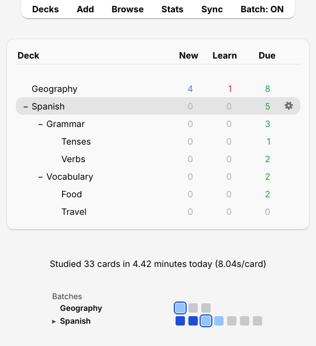
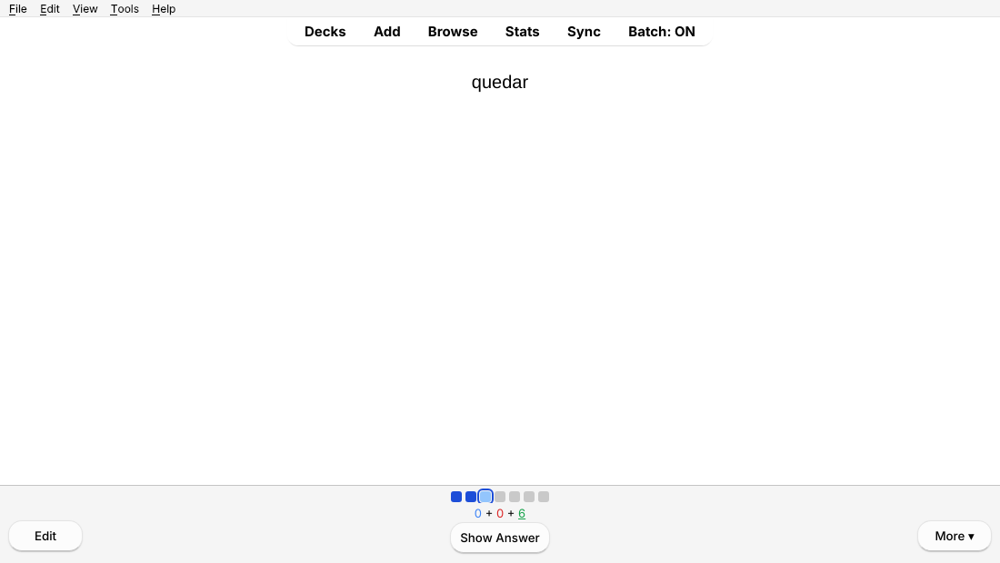
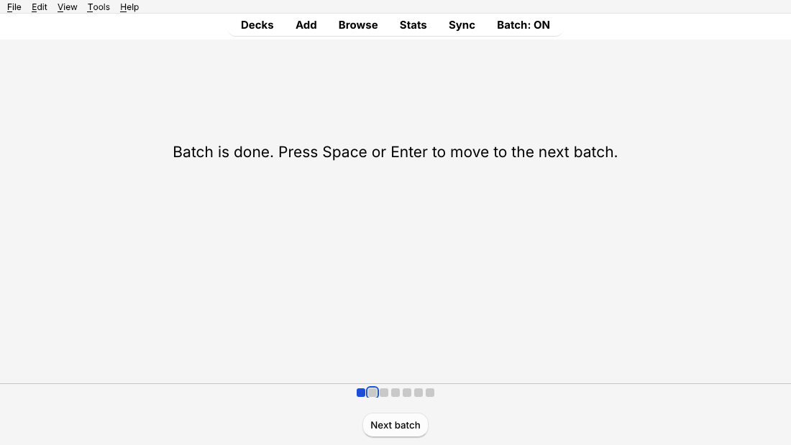
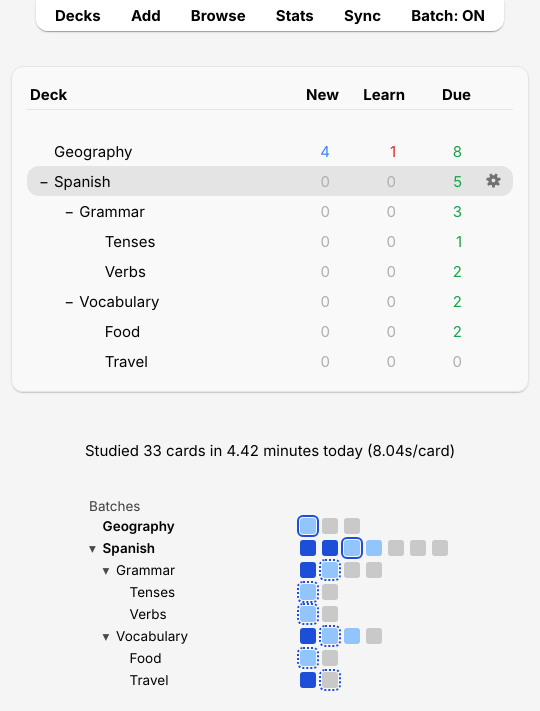
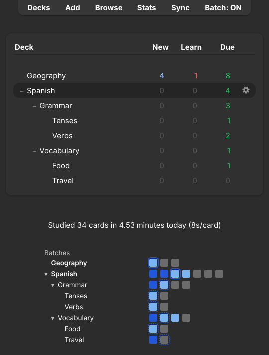
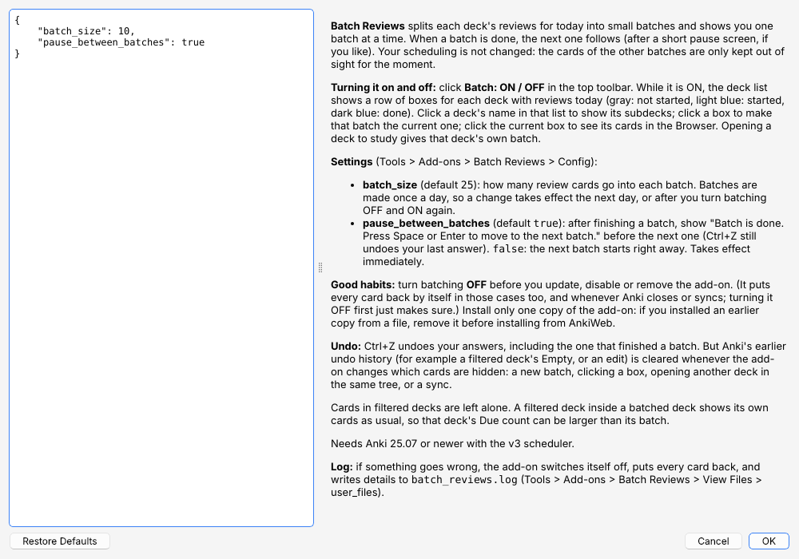

# Batch Reviews

An Anki add-on that shows the day's due reviews in fixed-size batches (25 cards by default), one batch at a time. When a batch is finished, the next one follows. Your scheduling is not changed: all reviews stay due, in Anki's normal order. The cards of the other batches are only kept out of sight for the moment.

## What it does

- It works on review cards only. New cards and learning cards follow your normal deck settings.
- A link in the top toolbar, **Batch: OFF** / **Batch: ON**, switches it. It starts OFF.
- While it is ON, the deck list shows a grid under the "Studied N cards..." line: one row of boxes per deck with reviews today, one box per batch. The reviewer shows the row of the deck you are studying in its bottom bar.
  - gray: not started
  - light blue: started
  - dark blue: done
  - a ring marks each deck's current batch (a dotted ring if that deck is not the one being studied in its tree right now)
- Every deck has its own batches, at every level. Opening a deck to study gives that deck's own batches.
- An optional pause screen between batches: "Batch is done. Press Space or Enter to move to the next batch."
- A batch counts as finished only when its relearning cards (cards you pressed Again on) are done for the day too.

## Install

**From AnkiWeb:** in Anki, open Tools > Add-ons > Get Add-ons, enter the code `1414284716` and restart Anki. Listing page: https://ankiweb.net/shared/info/1414284716

**From a file:** download `batch_reviews.ankiaddon` from this repository's [Releases](https://github.com/machpath/anki-batch-reviews/releases) page. In Anki, open Tools > Add-ons > Install from file..., choose the file and restart Anki.

Install only one copy (see "Good habits and known limits").

## How to use

1. Click **Batch: OFF** in the top toolbar to turn batching on. It now reads **Batch: ON**.
2. Optional: change the batch size in Tools > Add-ons > Batch Reviews > Config.
3. Study as usual. You see only the current batch of the deck you open.
4. When a batch is done, the pause screen appears. Press Space or Enter (or click **Next batch**) to go on.
5. Click **Batch: ON** to turn batching off. Every card is visible again straight away.

On the deck list:

- Click the name of a deck in the grid to show or hide its subdecks.
- Click the "Batches" heading to fold the whole grid away, and again to show it.
- Click a gray or light blue box to make that batch the current one.
- Click a dark blue box or the current box to see that batch's cards in the Browser.

In the reviewer's bottom bar, clicking another box switches to that batch at once.

The grid with the tree opened two levels:

The same in Anki's dark theme:

## Settings

Tools > Add-ons > select Batch Reviews > Config.

| Setting | Default | What it does |
|---|---|---|
| `batch_size` | `25` | How many review cards go into each batch. Batches are made once a day, so a change takes effect the next day, or after you turn batching OFF and ON again. |
| `pause_between_batches` | `true` | Show the pause screen after each batch. With `false`, the next batch starts right away. Takes effect immediately. |

## Requirements

- Anki 25.07 or newer, with the v3 scheduler (the default in current Anki).
- Tested on Anki 25.07, 25.09, 26.05, 26.08 and 26.09.4 on Linux, and on 26.09.4 on Windows. Not tested on macOS.
- At startup the add-on checks that your Anki behaves the way it expects. If it does not (for example, the v3 scheduler is off, or a newer Anki changed something the add-on needs), the toolbar link reads **Batch: unavailable** and the add-on does nothing. Click the link to see the reason.

## How it works

At the start of the day the add-on takes the review cards Anki would give you today for each deck, in Anki's own order, and cuts that list into batches.

The cards of the batches you are not studying are hidden with Anki's own "buried" state. The add-on writes this state directly, without marking the cards as modified, so the change is never sent to AnkiWeb. It keeps a list of exactly which cards it hid and how they were before.

Everything is put back:

- before every sync,
- when Anki closes or you switch profiles,
- before an export that includes scheduling,
- when you turn batching OFF,
- when the add-on is updated, disabled or removed in Tools > Add-ons. The add-on then pauses itself: the toolbar link reads **Batch: restart Anki**, and clicking it explains that the add-on paused itself and every hidden card is back. It stays paused until Anki is restarted, also if you enable it again in the meantime.

After a sync it hides the later batches again. So other devices always see the full due count.

A card is only put back if it is still exactly as the add-on left it. If something unexpected happens, the add-on switches itself off, puts every card back and writes the details to its log.

Cards in filtered decks are left alone: they are not put into batches and never hidden. A filtered deck inside a batched deck shows its own cards as usual, so that deck's Due count can be larger than its batch.

## Good habits and known limits

- **Turn Batch OFF before you update, disable or remove the add-on.** The add-on puts every card back by itself in those cases too; turning it OFF first just makes sure.
- **Install only one copy.** If you installed a copy from a file, remove it in Tools > Add-ons (and restart Anki) before you install from AnkiWeb. If two copies are installed anyway, only one works and a message names both add-on folders; remove the other one.
- **After a crash**, hidden cards come back the next time Anki opens the profile. If the add-on's record of hidden cards is lost (rare), they come back at Anki's next day rollover. The Unbury button on the deck's overview brings them back at once, but it also unburies cards you buried yourself.
- **Automatic backups** that Anki makes during a session can contain the hidden state. If you restore such a backup, the hidden cards come back at the next day rollover, or at once with Unbury.
- **Undo:** Ctrl+Z undoes your answers, including the one that finished a batch (also on the pause screen). But Anki's earlier undo history (for example a filtered deck's Empty, or an edit) is cleared whenever the add-on changes which cards are hidden: a new batch, clicking a box, opening another deck in the same tree, or a sync.
- **The Due column** on the deck list counts only the cards of the current batch (except for cards of a filtered deck inside a batched deck, see "How it works").
- **Waiting relearning cards:** if a card you pressed Again on is not due yet, the batch is not finished. The grid then says "↻ N to redo · open <deck> and Study Now".

## FAQ

**Does it work on my phone?**
No. Add-ons only run in Anki on a computer (Windows, Mac, Linux), not in the phone apps. Your phone, and AnkiWeb, show all of your due cards as usual, because everything is put back before every sync.

**Why do the Browser or the statistics show "buried" cards?**
During a session, the cards of the other batches are buried. They are put back when you turn batching off, sync or close Anki.

**How do I change the batch size?**
Tools > Add-ons > Batch Reviews > Config, then edit `batch_size`. The new size is used from the next day, or after you turn batching OFF and ON again.

**How do I turn it off?**
Click **Batch: ON** in the toolbar.

**Does it change my intervals or due dates?**
No. It only decides which of today's due reviews are visible right now. Answers are scheduled by Anki as usual.

**The toolbar says "Batch: restart Anki".**
The add-on was updated, disabled or removed in Tools > Add-ons, so it paused itself and put every hidden card back. Restart Anki to continue.

**The toolbar says "Batch: unavailable".**
The startup check found something in your Anki that the add-on cannot work with. Click the link to see the reason. Nothing is hidden while it is unavailable.

## Reporting a problem

Please open an issue on this repository's [Issues](https://github.com/machpath/anki-batch-reviews/issues) page. Include:

1. Your Anki version (Help > About; the "Copy Debug Info" button copies it).
2. Your operating system.
3. What you did, what you expected and what happened, step by step.
4. The add-on's log file, `batch_reviews.log` (see below), or the part of it from the time of the problem.

The log can contain deck names and, in error details, file paths that include your computer's user name. Look it over and remove anything you do not want to share before you post it.

## Where the log is

Tools > Add-ons > select Batch Reviews > View Files > open the `user_files` folder > `batch_reviews.log`.

The same folder holds the add-on's state for each profile (`state-<profile>-<code>.json` and its `.ledger` file). Nothing in it is synced, and Anki keeps the folder when the add-on is updated. Please do not edit these files.

## Source

The add-on's files are in [`src/batch_reviews/`](src/batch_reviews). The `.ankiaddon` file is a zip of the contents of that folder (not the folder itself), without `__pycache__` folders or `meta.json`.

Changes are listed in [CHANGELOG.md](CHANGELOG.md).
